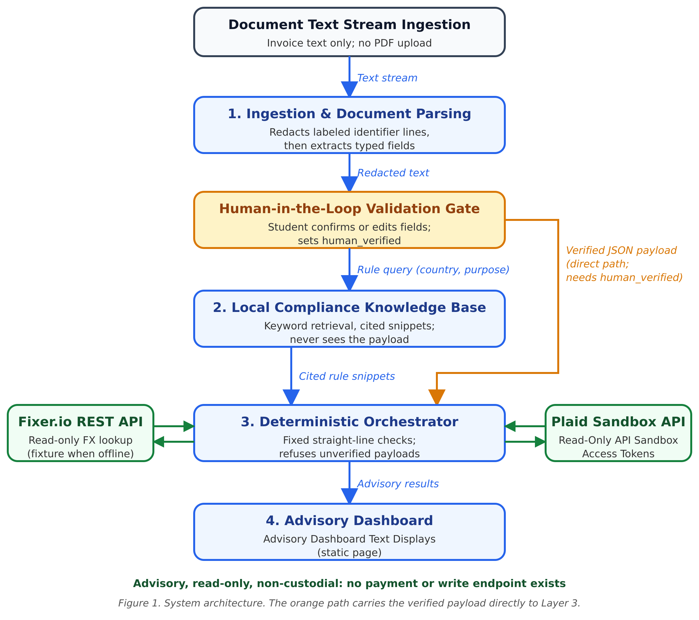
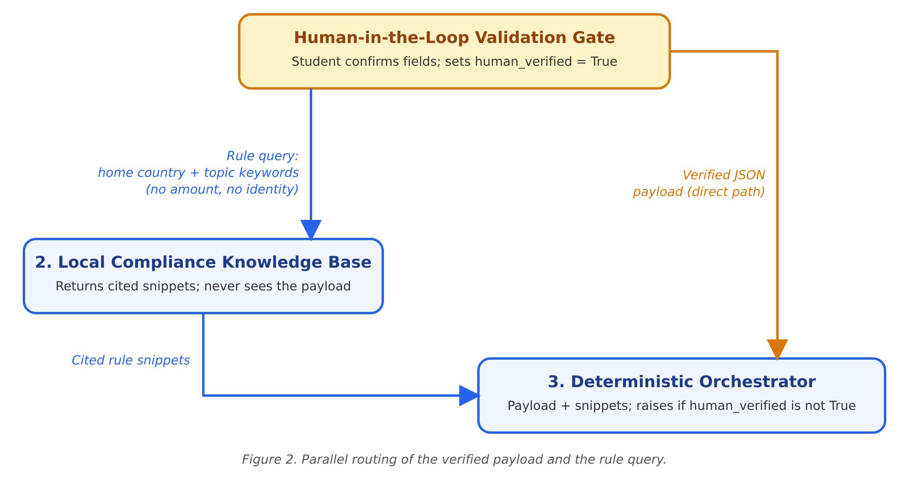

# AuraRoute AI

**AI as a Financial Participant:** an explainable, read-only, non-custodial, compliance-first advisory agent that plans cross-border tuition payments for international students.
Submission for the 2026 Shenzhen FinTechathon, International Track, Topic C (Cross-border & Student Finance Assistant).

AuraRoute AI reads a tuition invoice, redacts personal identifiers, asks the student to confirm the parsed values, retrieves relevant rule text from a local knowledge base, and checks the payment against exchange rates and read-only balances. It reports the amount in USD, whether the payment fits the remaining annual foreign-exchange quota, the latest safe date to start a transfer, and whether the remaining balance looks adequate.

It is **advisory and read-only**. It never moves, splits or routes money, and it makes no legal or immigration determinations.

## Architecture



The verified payload goes directly to the orchestrator. Only a rule query goes to the knowledge base, which returns cited snippets.



| Stage | Code |
|---|---|
| 1. Ingestion and redaction | `parse_and_sanitize_invoice` |
| Human validation gate | `human_in_the_loop_gate` |
| 2. Local rule retrieval | `retrieve_rules` |
| 3. Deterministic orchestrator | `execute_compliance_routing_check` |
| Read-only tools | `fetch_fx_rate` (Fixer.io), `fetch_sandbox_balances` (Plaid Sandbox) |
| Model output validation | `validate_llm_extraction`, `llm_fallback_extract` |
| Audit trail | `audit_log`, `verify_audit_log` |
| 4. Dashboard | `dashboard.html`, generated by `run_demo.py` |

## Submission map (2026 FinTechathon items 01 to 06)

| Item | Where |
|---|---|
| 01 Technical documentation | `01_Technical_Documentation/` |
| 02 Presentation deck | `02_Presentation_Deck/` |
| 03 Demo video (optional) | `03_Demo_Video/` |
| 04 Source code, README, tests | this folder (`04_Source_Code/`) |
| 05 Security self-assessment (Permission Tiers, Known-Risk List) | `05_Security_Self_Assessment/` |
| 06 Execution evidence (sandbox operation log) | `06_Execution_Evidence/` |

## Quick start

Requires Python 3.9 or newer. The core and the tests use only the standard library.

```bash
git clone https://github.com/samfar2022/auraroute-ai.git
cd auraroute-ai
python3 -m venv venv
source venv/bin/activate
```

Run the unit tests (29 in total: 25 in `tests/test_core.py` and 4 in `tests/test_extended_redaction.py`; both files run together):

```bash
python -m unittest discover -s tests -v
```

Expected result: `Ran 29 tests ... OK`.

Run the end-to-end demo. You will be asked to confirm the parsed invoice values:

```bash
python run_demo.py
```

For a non-interactive run (this is how `execution_evidence_logs.txt` is produced), add `--auto-confirm`:

```bash
python run_demo.py --auto-confirm
```

Then open `dashboard.html` in a browser.

The demo writes `execution_evidence_logs.txt`, `dashboard.html` and `audit.log`.

## Live Fixer.io and Plaid Sandbox mode (optional)

Without credentials the demo uses recorded fixtures, and the log says so. To use the live services:

```bash
pip install -r requirements.txt
cp .env.example .env     # then add your keys; .env is git-ignored
python run_demo.py --auto-confirm
```

The log's `Mode` line shows `LIVE` when keys are set. If a live exchange-rate call fails, the system falls back to the recorded fixture, records an audit event and labels the result's `fx_source` as `fixture-fallback`.

## Optional model fallback (the AI step)

If an invoice does not match the regex patterns, `llm_adapter.py` can ask a model to fill the missing fields. Only **redacted** text is sent, the reply is treated as untrusted and must pass `validate_llm_extraction`, and the model can only fill fields the regexes missed. It can never mark a payload as verified; the student still confirms every value.

1. Get a key. Google's Gemini API has a rate-limited free tier through Google AI Studio (aistudio.google.com/app/apikey). Anthropic's API is paid. Check current limits on the provider's site.
2. Put it in `.env`:
   ```
   LLM_PROVIDER=gemini
   GEMINI_API_KEY=your-key
   ```
3. Run the demo on the messy invoice, which the regexes cannot read:
   ```bash
   python run_demo.py --invoice data/sample_invoice_messy.txt --log-file execution_evidence_logs_llm.txt
   ```

Free-tier terms may allow providers to use submitted content to improve their products. Use only synthetic or redacted text with a free key. The unit tests exercise the adapter with mocked responses; the live call path depends on your key and the provider's current API.

## The sample scenario

`data/sample_invoice.txt` is a synthetic invoice for 12,000 GBP due 2026-12-15. `data/user_profile.json` has a student from China (`CN`) who has already used 42,000 USD of a 50,000 USD annual quota and holds 16,500 USD in two sandbox accounts. At the recorded rate of 1.27, the invoice is 15,240 USD, which:

- exceeds the remaining 8,000 USD quota, so the tool flags it and advises the bank's documented tuition-payment route (typically the admission letter and the tuition certificate) and says not to split the payment;
- leaves a projected balance of 1,260 USD, below the 2,500 USD illustrative framework baseline, so a balance warning is raised;
- gives a latest safe initiation date of 2026-12-10 (due date minus a 5-day clearing buffer).

## Data files

| File | Purpose |
|---|---|
| `data/rules_database.json` | Thresholds: annual quota per country, illustrative framework baseline for the post-payment balance, clearing buffer days |
| `data/regulatory_snippets.json` | Five paraphrased rule entries with source type, URL and a verify note. Two cite SAFE pages (2007 Q&A, 2009 news item), two cite a Bank of China page, and one cites the GOV.UK Student visa money page (UK-bound students; swap in the destination country's official page for other countries) |
| `data/user_profile.json` | Synthetic student profile and sandbox accounts |
| `data/sample_invoice.txt` | Synthetic invoice |

The quota figure, the buffers and the sample snippets are illustrative defaults. In particular, the 2,500 USD figure is an illustrative framework baseline, far below real maintenance requirements and living costs, which vary by country, city and time. It is not the UK's official maintenance figure, which is set in the Immigration Rules and changes over time. Verify them against current official guidance before relying on them.

## Security notes

- Read-only and non-custodial: no payment or write endpoints exist. The only POST request is Plaid's balance read.
- Identifying lines (name, passport number, phone, email, government/national ID, address, student ID, date of birth) are redacted before extraction and before any model call.
- Model output is untrusted: it must pass strict validation, can only fill fields the regular expressions missed, and can never mark a payload as verified.
- The orchestrator refuses any payload that the human gate has not verified.
- The audit log is hash-chained: it is tamper-evident, not tamper-proof.
- Secrets come from environment variables. Never commit `.env`.

See the Security Self-Assessment Report for the permission tiers and the known-risk list.

## Limitations

- The model-facing path implemented here is the extraction fallback (`llm_fallback_extract`) with Gemini and Anthropic adapters. The adapters are tested with mocked responses only; check the live path with your own key.
- Retrieval is keyword-based over five paraphrased entries. Verify them against current official text before relying on them.
- The prototype has no authentication or multi-user separation.
- Redaction covers labeled lines only.
- Outputs are planning information and do not replace guidance from a bank, institution or consulate.

## Project layout

```
auraroute_core.py        core logic
llm_adapter.py           optional Gemini/Anthropic adapter for the extraction fallback
run_demo.py              end-to-end demo, writes the evidence log and dashboard
tests/test_core.py       unit tests
tests/test_extended_redaction.py   supplementary tests: eight redaction labels, bank-route wording, quota advice
data/                    rules, sample corpus, synthetic profile and invoice
docs/                    architecture diagrams
requirements.txt         optional dependency (requests)
.env.example             optional credentials template
```

## Third-party services and licenses

- Fixer.io and Plaid Sandbox are optional external services used under their own terms.
- `requests` is an optional dependency under the Apache 2.0 license.
- All sample data is synthetic.
